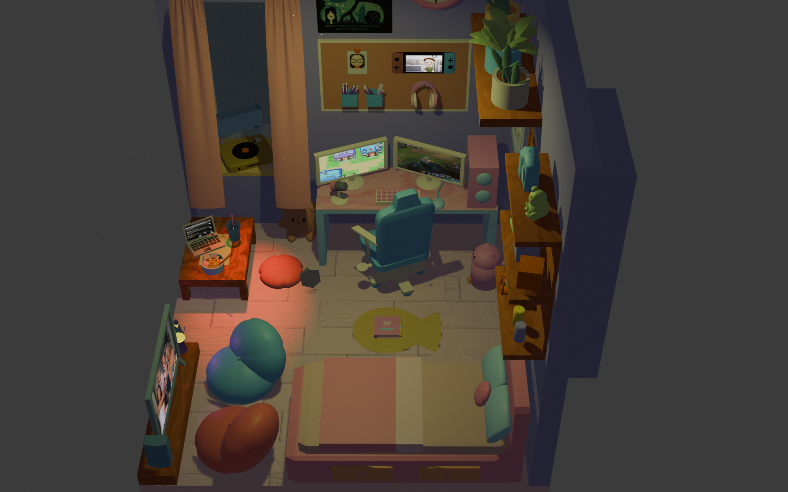

# Naiara Manteiga Cendón · Portfolio

**🔗 [nmanteiga.github.io/portfolio_NaiaraManteigaCendon](https://nmanteiga.github.io/portfolio_NaiaraManteigaCendon/)**

Mi portfolio personal: estudiante de último curso de Ingeniería Informática en la Universidad de A Coruña, cofundadora de GDG A Coruña y amante de la IA, el 3D y la comunidad tech.

Escanea el QR para abrirlo en el móvil 📱

<br clear="right" />



## ✨ Qué hay en la web

- **Cabecera 3D**: mi habitación, modelada y animada en Blender y exportada a Three.js, con sus 53 animaciones, la simulación de tela de las cortinas, el humo y el polvo recreados en la web.
- **Sobre mí**: presentación, CV para ver o descargar y una pila de polaroids interactiva.
- **GDG A Coruña**: los eventos se cargan **en directo desde Bevy**, y se muestran el próximo evento y mis diseños para la comunidad, agrupados por año.
- **Proyectos**: mi TFG, hackathons, prácticas de la carrera y game jams.
- Y una sorpresa en ordenador: mi gata siberiana persigue el cursor 🐈

## 🛠️ Tecnologías

[Vite](https://vite.dev) · HTML, CSS y JavaScript sin framework · [Three.js](https://threejs.org) · [Blender](https://www.blender.org) · API pública de Bevy (gdg.community.dev) · GitHub Pages + GitHub Actions

## 💻 Ejecutarla en local

```bash
npm install
npm run dev        # http://localhost:5173
```

Para ajustar la iluminación de la habitación en vivo, abre `http://localhost:5173/?luces`.

## 🚀 Publicación

Cada `push` a `main` compila y publica la web automáticamente en GitHub Pages ([.github/workflows/deploy.yml](.github/workflows/deploy.yml)). Además se recompila cada día para mantener al día la copia de respaldo de los eventos de GDG.

## 📁 Dónde está cada cosa

| Carpeta / archivo | Contenido |
| --- | --- |
| `contents/` | Fotos, diseños de GDG, capturas de proyectos y modelos 3D originales |
| `src/data/projects.js` | Textos y enlaces de la sección de proyectos |
| `src/data/gdg-designs.js` | A qué evento pertenece cada diseño |
| `src/lighting.js` | Ajustes de luces, polvo y humo de la habitación |
| `public/` | CV, modelos optimizados y vídeos |
